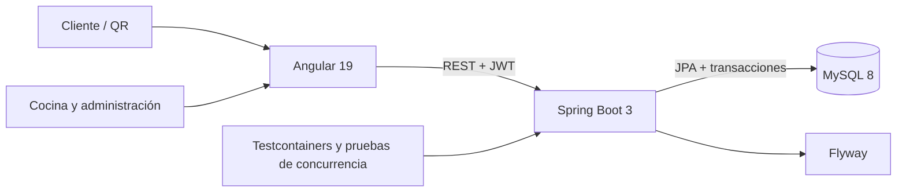

# ChefTable Web

Frontend de una plataforma de pedidos en mesa para restaurantes. El cliente accede desde el QR de su mesa, explora el menú, prepara un carrito, confirma el pedido y sigue su avance. Cocina y administración cuentan con pantallas protegidas por rol.

> Proyecto universitario modernizado como caso de portafolio full stack. El objetivo es demostrar decisiones reales de producto, concurrencia, seguridad y experiencia de usuario, no simular un sistema comercial en producción.

## Funcionalidades

- Landing responsive integrada en Angular.
- Acceso por mesa y simulación de QR para la demostración.
- Menú con búsqueda, categorías, disponibilidad, skeleton loading y estados de error.
- Carrito con Signals, persistencia por sesión y control de stock visible.
- Checkout con revalidación de disponibilidad e idempotencia.
- Seguimiento público del pedido mediante código no secuencial.
- Tablero de cocina con transiciones de estado controladas.
- Administración de platos y disponibilidad.
- Login, JWT, guards y autorización por roles `ADMIN` y `KITCHEN`.
- Diseño responsive, animaciones accesibles y soporte para movimiento reducido.

## Arquitectura



El frontend se organiza por funcionalidades y utiliza componentes standalone, lazy loading, Signals, interceptores y guards. Las reglas críticas permanecen en la API.

## Stack

- Angular 19, TypeScript y RxJS
- Spring Boot 3, Java 17 y Spring Security
- MySQL 8, JPA y Flyway
- JWT, OpenAPI, Testcontainers y k6
- GitHub Actions

Backend: [API-ChefTable](https://github.com/dayanaArmasB/API-ChefTable)

## Requisitos

- Node.js 22 LTS
- npm 10 o superior
- API ejecutándose en `http://localhost:8080`

Con `nvm`:

```bash
nvm use
npm ci
npm start
```

La aplicación estará disponible en `http://localhost:4200`.

Para recorrer la demostración, abre la landing y selecciona uno de los accesos que simulan el QR de una mesa.

## Calidad

```bash
npm test          # pruebas unitarias en ChromeHeadless
npm run build     # bundle de producción y presupuestos
npm run check     # pruebas y compilación
npm run test:watch
```

GitHub Actions ejecuta pruebas y compilación en cada cambio dirigido a `master`.

## Seguridad

- No se versionan archivos `.env`, contraseñas ni secretos JWT.
- El frontend no decide precios, stock ni permisos.
- Los guards mejoran la navegación; Spring Security aplica la autorización real.
- El carrito no reserva stock. La asignación ocurre transaccionalmente al confirmar.
- La misma petición puede reintentarse sin duplicar el pedido gracias a `Idempotency-Key`.

## Documentación

- [Índice](docs/README.md)
- [Visión del producto](docs/PRODUCT.md)
- [Arquitectura](docs/ARCHITECTURE.md)
- [Sistema de diseño](docs/DESIGN_SYSTEM.md)
- [Desarrollo local](docs/DEVELOPMENT.md)
- [Roadmap](docs/ROADMAP.md)
- [Checklist de portafolio](docs/PORTFOLIO_CHECKLIST.md)

## Estado

El flujo vertical principal está implementado y cubierto por pruebas unitarias y de concurrencia. Antes de presentarlo como una aplicación desplegada todavía se requiere configurar hosting, usar tokens opacos para los QR y automatizar al menos un recorrido E2E contra el sistema completo.
